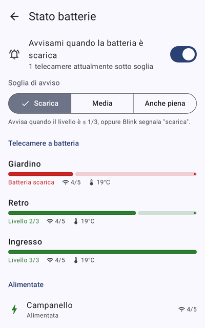
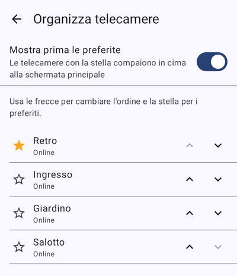

# Blink Cam (Blink-android)


Un progetto **DaboPrint3D** — *Design & Printing* · [canale YouTube DaboPrint3D](https://www.youtube.com/@daboPrint3d)

App Android **non ufficiale** per controllare le telecamere di casa Blink, con in più la
possibilità di **aggiornare automaticamente le miniature a intervalli configurabili**.

<p>
  
  
  
  
  
</p>

## Funzionalità

Come l'app Blink:

- Accesso con email e password del proprio account Blink, con **verifica in due passaggi** (codice via SMS/email).
  La password non viene salvata: l'app conserva solo i token, cifrati con l'Android Keystore.
- Elenco dei sistemi con **inserimento/disinserimento** (Armato / Disarmato).
- Griglia delle telecamere con miniatura, orario dello scatto, avvisi di batteria scarica / offline.
- **Nuova miniatura** su richiesta (singola telecamera o tutte insieme).
- **Rilevamento movimento** attivabile per singola telecamera.
- Dettaglio telecamera: miniatura ingrandibile (pinch-to-zoom), batteria, segnale Wi-Fi e Sync Module,
  temperatura, firmware, **registrazione di una clip** e clip recenti.
- **Clip**: elenco per periodo (24 h / 7 / 30 / 60 giorni), filtro per telecamera, riproduzione ed eliminazione.
- Supporta telecamere con Sync Module (Outdoor, Indoor, XT…), **Blink Mini** e **Video Doorbell**.

Funzioni aggiuntive:

- **Widget in home screen**: le miniature delle telecamere preferite direttamente sulla schermata del
  telefono, con pulsante per aggiornarle; si aggiorna da solo quando gira l'aggiornamento automatico.
  Le miniature mostrate restano visibili anche se l'app è chiusa (vengono lette dalla cache su disco).
- **Tile delle impostazioni rapide**: nel menu a tendina di Android, un riquadro che arma/disarma al volo
  tutti i sistemi e ne mostra lo stato.
- **Stato batterie**: una schermata con il livello di tutte le telecamere (dalla più scarica), Wi-Fi e
  temperatura, e una **notifica** quando una scende sotto la soglia scelta.
- **Preferiti e ordine**: contrassegna le telecamere con la stella (compaiono in cima) e riordinale a piacere;
  l'ordine vale anche per il widget.

In più — **aggiornamento automatico delle miniature**:

- Interruttore generale e **intervallo predefinito** (1 minuto … 7 giorni; valori pronti o personalizzato).
- **Intervallo diverso per ogni telecamera**, oppure esclusione della telecamera.
- **Fascia oraria** opzionale (anche a cavallo della mezzanotte, es. 22:00–06:00).
- Condizione sullo stato del sistema: sempre / solo armato / solo disarmato.
- Salta le telecamere con **batteria scarica** e quelle offline.
- In background solo con **Wi-Fi** (opzionale).
- Funziona anche **con l'app chiusa** (WorkManager) e, ad app aperta, con un ciclo in primo piano preciso.
- Stato dell'ultimo giro (aggiornate / saltate / errori) e orario del prossimo controllo;
  pulsante "Aggiorna ora".

### Come viene deciso quando aggiornare

Una telecamera viene aggiornata quando è trascorso il suo intervallo dall'**ultima miniatura disponibile**
(scattata automaticamente, a mano o da un evento di movimento) o dall'ultimo tentativo. Così non si scattano
foto inutili se la miniatura è già recente, e una telecamera offline non viene ritentata di continuo.

Ogni scatto consuma un po' di batteria sulle telecamere non alimentate: per quelle conviene un intervallo ampio.

## Installazione

1. Scarica l'APK dagli artifact della GitHub Action **Android build** (`blink-cam-apk` → `app-release.apk`),
   oppure compilalo (vedi sotto).
2. Sul telefono consenti l'installazione da origini sconosciute e apri l'APK.
3. Accedi con le credenziali Blink e inserisci il codice di verifica che ricevi.
4. Vai in **Impostazioni** (icona ingranaggio) e attiva *Aggiorna le miniature automaticamente*.

Per intervalli sotto i 15 minuti con il telefono inattivo, Android (modalità Doze) può ritardare le esecuzioni:
il pulsante **Batteria** nelle impostazioni permette di escludere l'app dall'ottimizzazione batteria.

## Compilazione

Requisiti: JDK 17+, Android SDK (platform 36).

```bash
./gradlew testDebugUnitTest      # unit test (API simulate con MockWebServer + rendering schermate con Robolectric)
./gradlew assembleRelease        # APK in app/build/outputs/apk/release/
```

La build *release* è minificata con R8 e firmata con la chiave di debug, così l'APK è installabile direttamente
(app per uso personale, non destinata al Play Store).

## Struttura del codice

| Package | Contenuto |
|---|---|
| `data/api` | Client OAuth 2.0 + PKCE (login, 2FA, refresh), client REST Blink, modelli e URL dei media |
| `data/auth` | Sessione, cifratura Keystore, rinnovo automatico dei token |
| `data/settings` | Impostazioni dell'aggiornamento automatico e `AutoRefreshPlanner` (logica pura e testata) |
| `data/thumbs` | Cache su disco delle miniature |
| `work` | `AutoRefreshEngine`, worker WorkManager, scheduler e ciclo in primo piano |
| `data/prefs` | Preferenze telecamere (ordine, preferiti, soglia batteria) e logica di ordinamento |
| `ui` | Schermate Jetpack Compose (login, home, telecamera, clip, player, impostazioni, batterie, organizza) |
| `widget` | Widget home screen (Glance) e snapshot su disco che legge |
| `tile` | Tile delle impostazioni rapide per armare/disarmare |

## Privacy e sicurezza

Per massima trasparenza, ecco esattamente con chi parla l'app e quali garanzie offre.

**Host contattati** — solo i server ufficiali di Blink/Immedia, nessun'altra destinazione:

| Host | Uso |
|---|---|
| `api.oauth.blink.com` | Login OAuth e verifica in due passaggi |
| `rest-prod.immedia-semi.com` | Regione dell'account (tier) |
| `rest-<regione>.immedia-semi.com` | Telecamere, miniature, clip e comandi |

Non c'è **nessun server intermedio**, **nessuna telemetria**, **nessun tracker** e nessun dominio di terze parti.
(Gli unici altri link presenti sono il canale YouTube e un riferimento a blinkpy nei commenti: non ricevono dati.)

**Garanzie** (verificabili nel codice):

- Email e password vengono inviate **solo a Blink**, in **HTTPS** con verifica standard del certificato: nessun
  bypass TLS, nessun traffico in chiaro.
- La **password non viene mai salvata**: l'app conserva solo i token di accesso, **cifrati con l'Android Keystore**
  (AES-GCM 256 bit).
- **Backup disattivato** (`allowBackup=false`): i token non finiscono nei backup cloud né nei trasferimenti tra dispositivi.
- **Permessi minimi**: Internet, stato rete, notifiche (opzionali) ed esclusione dall'ottimizzazione batteria (opzionale).
- Codice **open source**: chiunque può verificare tutto quanto sopra.

**Da sapere:**

- L'app si identifica verso Blink come client iOS (per compatibilità con l'API): è il motivo per cui Blink invia
  l'email "nuovo dispositivo ha effettuato l'accesso" al primo login.
- Essendo API non ufficiali, l'uso è a proprio rischio e dovrebbe rispettare i termini di servizio di Blink/Amazon.

## Limiti noti

- **API non ufficiali**: l'app usa le stesse API dell'app Blink (documentate dal progetto open source
  [blinkpy](https://github.com/fronzbot/blinkpy)). Blink può cambiarle senza preavviso; in quel caso il punto da
  aggiornare è `data/api/BlinkConstants.kt` / `OAuthClient.kt`. L'uso è a proprio rischio e deve rispettare i
  termini di servizio Blink.
- **Visione live** non disponibile: usa un protocollo proprietario (immis) non implementato.
- **Notifiche push** di movimento non disponibili (arrivano solo all'app ufficiale).

## Icona

L'icona (una "b" turchese con la mano col guanto arancione del logo DaboPrint3D) è disegnata in vettoriale
da `tools/icon/gen.py`, che genera i drawable in `app/src/main/res/drawable/ic_launcher_*.xml`:

```bash
python3 tools/icon/gen.py /tmp/anteprime app/src/main/res
```

## Autore

Realizzato da **DaboPrint3D** — seguimi sul [canale YouTube DaboPrint3D](https://www.youtube.com/@daboPrint3d).

Progetto non affiliato né approvato da Blink o Amazon.
